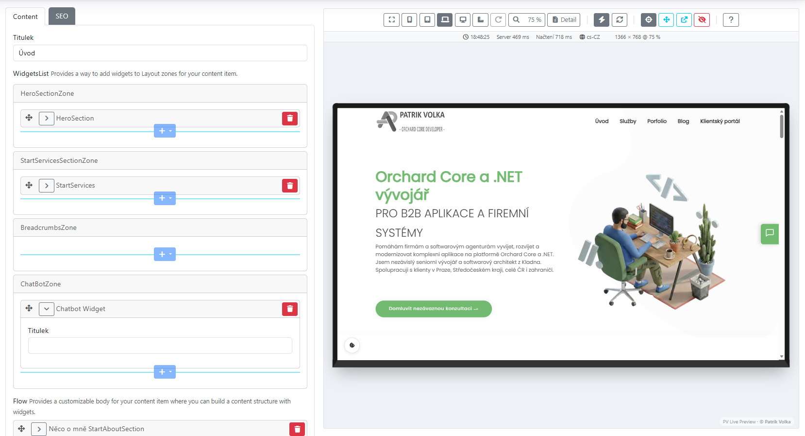
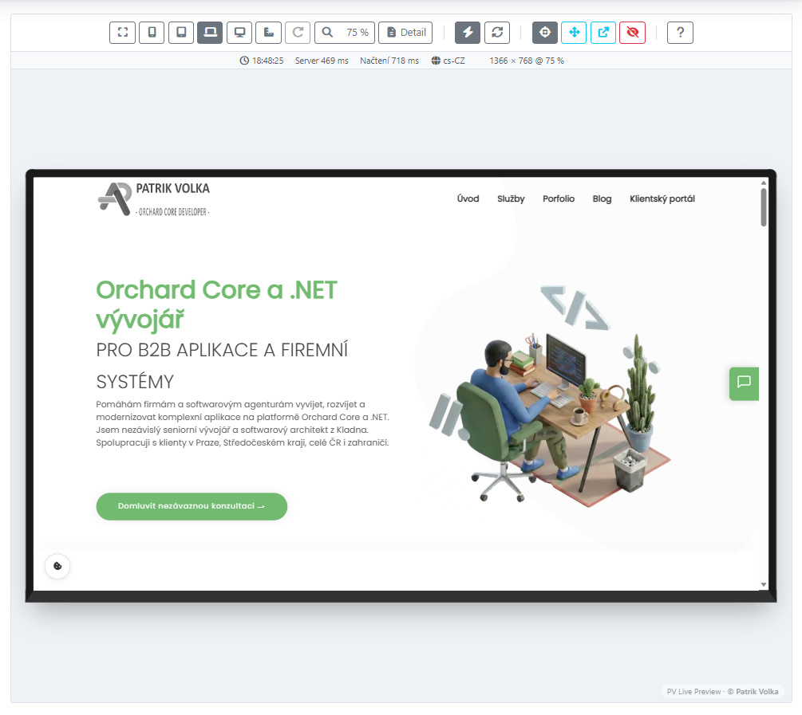

# PV Live Preview pro Orchard Core

[English](README.md) · **Čeština**

Modul pro [Orchard Core](https://orchardcore.net), který přidává responzivní **živý náhled** přímo do editoru obsahu. Při psaní ukazuje položku obsahu vykreslenou frontendovým tématem webu – na maketě mobilu, tabletu, laptopu nebo desktopu, vedle formuláře nebo v samostatném okně na druhém monitoru.

Náhled obsah nikdy neukládá ani nepublikuje.



## Funkce



- **Živá aktualizace bez bliknutí** – stránka se znovu vykreslí chvíli po každé změně ve formuláři (i ve WYSIWYG editorech jako TinyMCE) a zobrazí se až po úplném načtení; pozice posunu zůstává.
- **Posun na změny** – náhled se posune k prvnímu změněnému prvku a krátce ho zvýrazní.
- **Zařízení** – Fluid, mobil, tablet, laptop, desktop a vlastní rozměr; otočení na výšku / na šířku; pro každý typ obsahu lze definovat vlastní zařízení (např. `Galaxy S20; 412x915`).
- **Měřítko** – přizpůsobení zařízení panelu, nebo skutečná velikost (100 %) s posuvníky.
- **Detail / Souhrn** – stránka detailu položky, nebo jak vypadá ve výpisu (např. karta článku na blogu).
- **Správný jazyk** – vícejazyčný obsah (`LocalizationPart`) se vykreslí v kultuře položky.
- **Validační chyby** – chyby z editoru (např. URL už používá jiná položka) se ukážou v pruhu nad náhledem.
- **Samostatné okno** – náhled ve vlastním okně, formulář dostane celou šířku.
- **Rozložení** – panel vlevo, vpravo nebo dole, s nastavitelnou šířkou, přes celou obrazovku, lze skrýt.
- **Ruční režim** – u náročných stránek lze automatickou aktualizaci vypnout a obnovovat tlačítkem.
- **Informační lišta** – čas poslední aktualizace, odezva serveru, doba načtení stránky, kultura a viewport.
- **Klávesové zkratky** – všechny s prefixem `Alt+Shift`, aby nekolidovaly s prohlížečem ani editory.
- **Pamatované volby** – zařízení, orientace, měřítko, stav panelu a další se pamatují v prohlížeči.
- **Bezpečné výchozí chování** – odkazy se otevírají v nové záložce, formuláře v náhledu nejde odeslat a náhled nemůže přesměrovat administraci.

## Požadavky

- Orchard Core **3.0.1**
- .NET **10**

Verze modulu odpovídá verzi Orchard Core, pro kterou je sestavený.

## Instalace

1. Naklonujte nebo zkopírujte tento repozitář do svého řešení s Orchard Core, např. vedle webového projektu.
2. Přidejte projekt do řešení a odkažte se na něj z webového (hostitelského) projektu:

   ```xml
   <ProjectReference Include="..\PV.LivePreview\PV.LivePreview.csproj" />
   ```

3. Spusťte web a v **Konfigurace → Funkce** zapněte funkci **PV Live Preview** (kategorie *Content Management*).

## Nastavení

### Pro typ obsahu

V **Vzhled → Definice obsahu → Typy obsahu** otevřete typ obsahu a nastavte:

| Volba | Popis |
|---|---|
| Pozice živého náhledu | `Vypnuto`, `Vlevo`, `Vpravo` nebo `Dole` |
| Zařízení zobrazená v toolbaru | Která vestavěná zařízení se nabízejí |
| Vlastní zařízení | Jedno na řádek: `Název; šířka x výška` |
| Výchozí zařízení | Použije se, dokud si uživatel pro typ obsahu nezvolí zařízení |
| Zpoždění aktualizace (ms) | Jak dlouho po poslední změně počkat s obnovením náhledu (100–5000) |
| Při otevření editace skrytý | Pro typy obsahu s náročným vykreslením |

### Více typů obsahu najednou

**Vzhled → Definice obsahu → Živý náhled** zobrazí všechny typy obsahu s aktuální pozicí a umožní nastavit pozici vybraným typům jedním krokem.

### Oprávnění

| Oprávnění | Účel |
|---|---|
| **Use Live Preview when editing content** (`UseLivePreview`) | Kdo náhled uvidí. Výchozí přiřazení: Administrator, Editor, Author a Contributor. Uživatel musí zároveň smět položku upravovat. |
| Edit Content Types (Orchard Core) | Potřeba pro stránku hromadného nastavení. |

## Klávesové zkratky

| Zkratka | Akce |
|---|---|
| `Alt+Shift+L` | Skrýt / zobrazit náhled |
| `Alt+Shift+1` … `9` | Přepnout zařízení (v pořadí tlačítek v toolbaru) |
| `Alt+Shift+O` | Otočit zařízení |
| `Alt+Shift+0` | Měřítko: přizpůsobit / 100 % |
| `Alt+Shift+D` | Zobrazení: Detail / Souhrn |
| `Alt+Shift+Enter` | Celá obrazovka zapnout / vypnout |
| `Alt+Shift+R` | Obnovit náhled |
| `Alt+Shift+W` | Samostatné okno: otevřít / vrátit do panelu |
| `Esc` | Ukončit celou obrazovku |

## Jak to funguje

1. Formulář editoru se odešle (s antiforgery tokenem) na `api/pv-live-preview/render`.
2. Server z odeslaných dat sestaví **dočasnou** položku obsahu pomocí display driverů typu obsahu – do databáze se nic neukládá – a vykreslí ji frontendovým tématem.
3. Vykreslená stránka se krátce uloží v paměti pod náhodným tokenem vázaným na uživatele a iframe náhledu ji načte z `api/pv-live-preview/frame/{token}`. Dokument má vlastní URL (ne `srcdoc`), a proto se na něj vztahuje Content Security Policy webu, ne administrace.

### Bezpečnost

- Iframe náhledu má `sandbox="allow-scripts allow-same-origin allow-popups allow-popups-to-escape-sandbox"`. Prohlížeč blokuje odeslání formulářů (včetně `form.submit()`), přesměrování administrace a modální okna. `allow-same-origin` zůstává záměrně – závisí na něm fonty hostované tématem a přístup editoru do náhledu (posun, zvýraznění změn). Skripty náhledu proto proti administraci izolované **nejsou**; zobrazujte v náhledu jen obsah, kterému důvěřujete.
- Vykreslené náhledy se ukládají v paměti procesu (`IMemoryCache`) na 2 minuty, nejvýš 6 na uživatele. Při běhu více instancí serveru za load balancerem použijte sticky sessions.
- UI modulu používá jen externí CSS a JS – žádné inline skripty ani styly.

## Lokalizace

Všechny texty jsou lokalizovatelné. Český překlad je v `Localization/cs/PV.LivePreview.cs.po`. Další jazyky přidejte jako `Localization/{kultura}/PV.LivePreview.{kultura}.po`.

## Vývoj

- CSS a JS se při buildu minifikují podle `bundleconfig.json` (balíček `BuildBundlerMinifier2022`). Upravujte vždy neminifikované soubory ve `wwwroot`, soubory `*.min.*` se přegenerují.
- Orchard Core v režimu ladění prostředků (prostředí Development nebo **Nastavení → Obecné → Resource debug mode**) používá neminifikované soubory.

## Licence

[MIT](LICENSE) © 2023–2026 [Patrik Volka](https://patrik-volka.cz)
