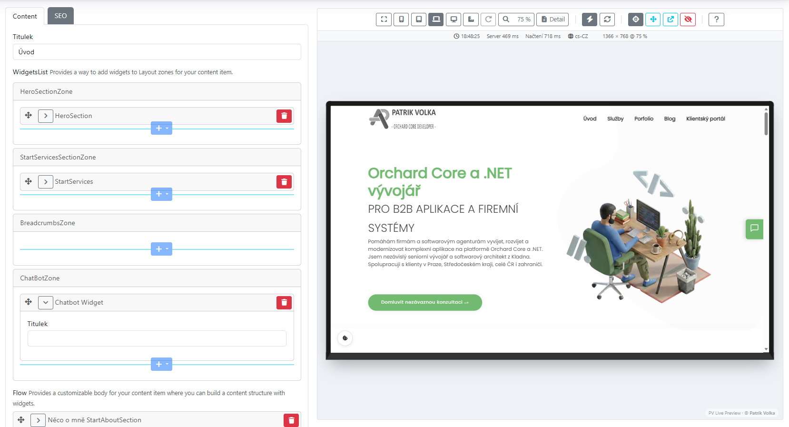
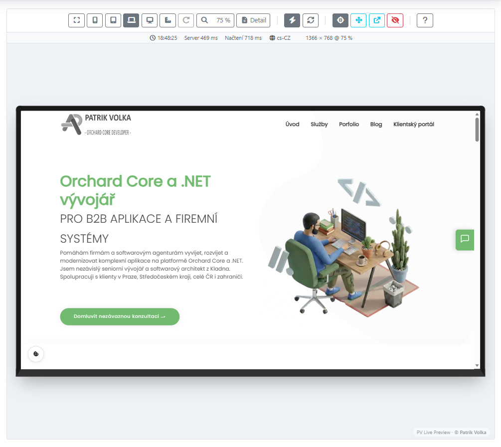

# PV Live Preview for Orchard Core

**English** · [Čeština](README.cs.md)

An [Orchard Core](https://orchardcore.net) module that adds a responsive **live preview** right into the content editor. While you type, the preview shows the content item rendered by your front-end theme – on a mobile, tablet, laptop or desktop mock-up, side by side with the form or in a separate window on a second monitor.

The content is never saved or published by the preview.



## Features



- **Live, flicker-free updates** – the page is re-rendered shortly after any change in the form (including WYSIWYG editors such as TinyMCE) and swapped in only when fully loaded; the scroll position is kept.
- **Scroll to changes** – the preview scrolls to the first changed element and briefly highlights it.
- **Devices** – Fluid, mobile, tablet, laptop, desktop and a custom size; rotate between portrait and landscape; per content type you can define your own devices (e.g. `Galaxy S20; 412x915`).
- **Scale** – fit the device into the panel, or view it in its real size (100 %) with scrollbars.
- **Detail / Summary** – see the item's detail page or how it looks in a list (e.g. a blog card).
- **Correct language** – multilingual content (`LocalizationPart`) is rendered in the culture of the item.
- **Validation errors** – errors from the editor (e.g. a URL already used by another item) are shown in a bar above the preview.
- **Separate window** – open the preview in its own window; the form gets the full width.
- **Layout** – panel on the left, right or bottom, resizable, fullscreen, can be hidden.
- **Manual mode** – turn automatic updates off for demanding pages and refresh on demand.
- **Info bar** – time of the last update, server response time, page load time, culture and viewport.
- **Keyboard shortcuts** – all with the `Alt+Shift` prefix so they don't clash with the browser or editors.
- **Remembered choices** – device, orientation, scale, panel state and more are remembered in the browser.
- **Safe by default** – links open in a new tab, forms in the preview cannot be submitted, the preview cannot redirect the admin.

## Requirements

- Orchard Core **3.0.1**
- .NET **10**

The module version follows the Orchard Core version it is built for.

## Installation

1. Clone or copy this repository into your Orchard Core solution, e.g. next to your web project.
2. Add the project to the solution and reference it from your web (host) project:

   ```xml
   <ProjectReference Include="..\PV.LivePreview\PV.LivePreview.csproj" />
   ```

3. Run the site and enable the **PV Live Preview** feature in **Configuration → Features** (category *Content Management*).

## Configuration

### Per content type

Open **Design → Content Definition → Content Types**, edit a content type and set:

| Setting | Description |
|---|---|
| Live Preview Position | `Disabled`, `Left Side`, `Right Side` or `Bottom` |
| Devices shown in the toolbar | Which built-in devices are offered |
| Custom devices | One per line: `Name; width x height` |
| Default device | Used until the user picks a device for this content type |
| Update delay (ms) | Wait time after the last change before the preview is refreshed (100–5000) |
| Hidden when the editor is opened | For content types whose rendering is demanding |

### Several content types at once

**Design → Content Definition → Live Preview** lists all content types with their current position and lets you set the position for the selected ones in one step.

### Permissions

| Permission | Purpose |
|---|---|
| **Use Live Preview when editing content** (`UseLivePreview`) | Who can see the preview. Granted by default to Administrator, Editor, Author and Contributor. The user must also be allowed to edit the item. |
| Edit Content Types (Orchard Core) | Required for the bulk settings page. |

## Keyboard shortcuts

| Shortcut | Action |
|---|---|
| `Alt+Shift+L` | Hide / show the preview |
| `Alt+Shift+1` … `9` | Switch the device (in the order of the toolbar buttons) |
| `Alt+Shift+O` | Rotate the device |
| `Alt+Shift+0` | Scale: fit to panel / 100 % |
| `Alt+Shift+D` | Display type: Detail / Summary |
| `Alt+Shift+Enter` | Fullscreen on / off |
| `Alt+Shift+R` | Refresh the preview |
| `Alt+Shift+W` | Separate window: open / return to the panel |
| `Esc` | Exit fullscreen |

## How it works

1. The editor form is posted (with the antiforgery token) to `api/pv-live-preview/render`.
2. The server builds a **transient** content item from the posted data using the content type's display drivers – nothing is stored in the database – and renders it with the front-end theme.
3. The rendered page is kept briefly in memory under a random, user-bound token and loaded by the preview `<iframe>` from `api/pv-live-preview/frame/{token}`. Because the document has its own URL (not `srcdoc`), it gets the site's Content Security Policy instead of the admin one.

### Security notes

- The preview iframe uses `sandbox="allow-scripts allow-same-origin allow-popups allow-popups-to-escape-sandbox"`. The browser blocks form submissions (including `form.submit()`), navigation of the admin page and modal dialogs. `allow-same-origin` is kept on purpose – the theme's self-hosted fonts and the editor's access to the preview (scrolling, highlighting changes) depend on it. Preview scripts are therefore **not** isolated from the admin; only preview content you trust.
- Rendered previews are stored in process memory (`IMemoryCache`) for 2 minutes, at most 6 per user. When running several server instances behind a load balancer, use sticky sessions.
- The module UI uses only external CSS and JS files – no inline scripts or styles.

## Localization

All texts are localizable. A Czech translation is included in `Localization/cs/PV.LivePreview.cs.po`. Add other languages as `Localization/{culture}/PV.LivePreview.{culture}.po`.

## Development

- CSS and JS are minified on build from `bundleconfig.json` (package `BuildBundlerMinifier2022`). Always edit the non-minified files in `wwwroot`; the `*.min.*` files are regenerated.
- Orchard Core serves the non-minified files in resource debug mode (Development environment or **Settings → General → Resource debug mode**).

## License

[MIT](LICENSE) © 2023–2026 [Patrik Volka](https://patrik-volka.cz)
